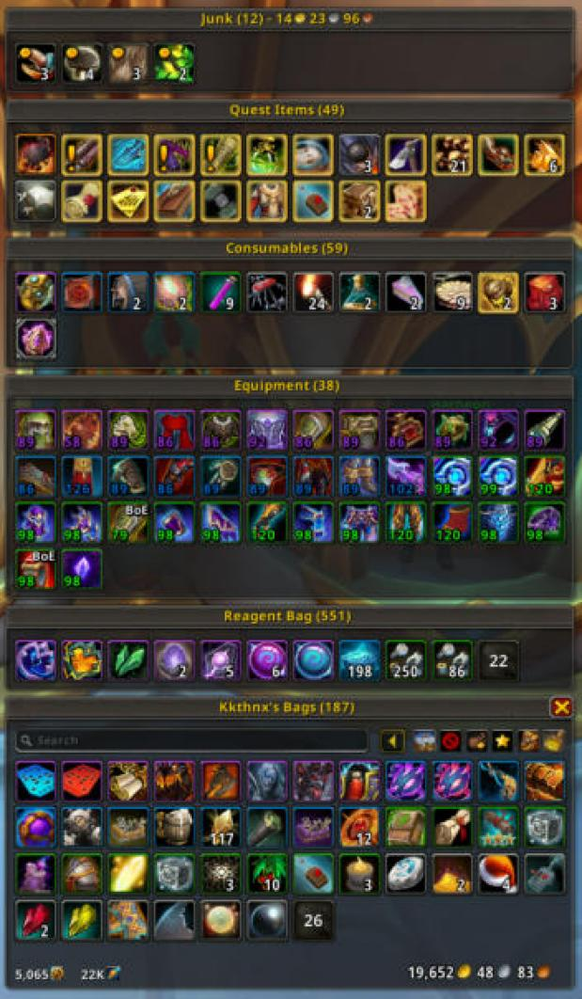
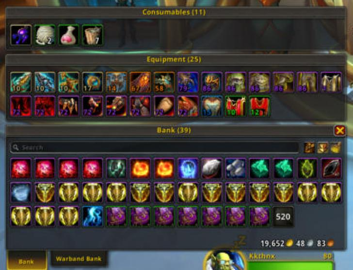
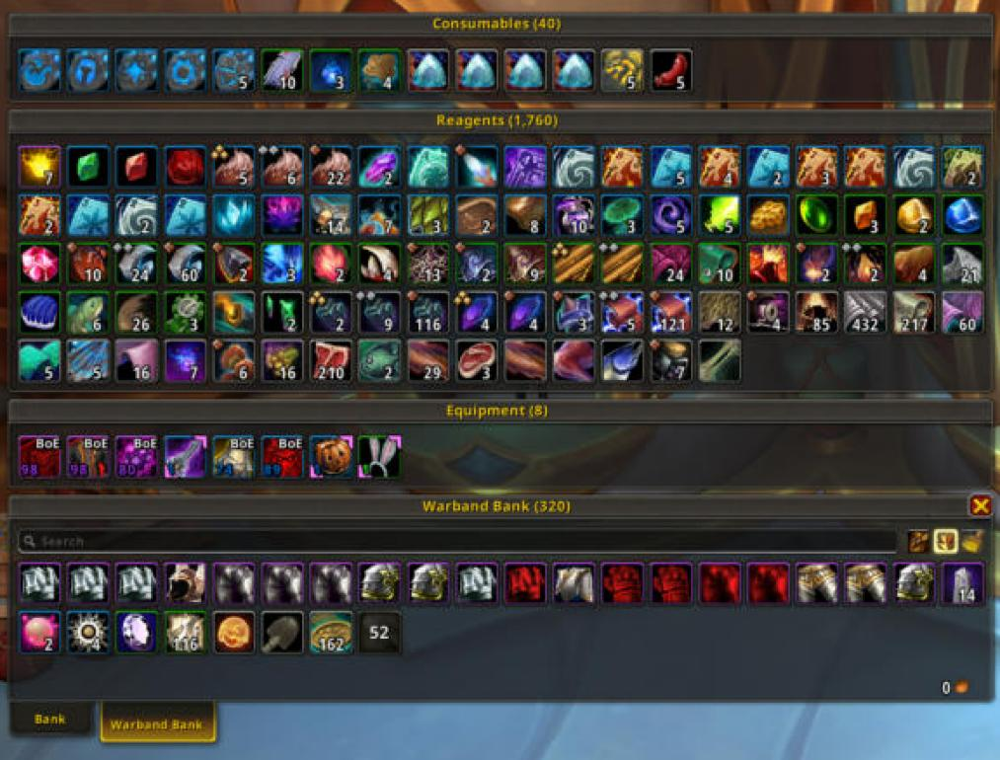
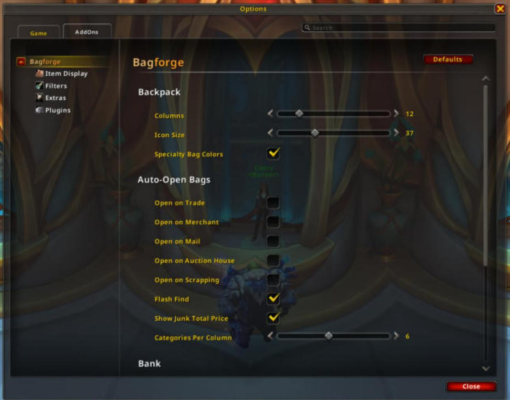
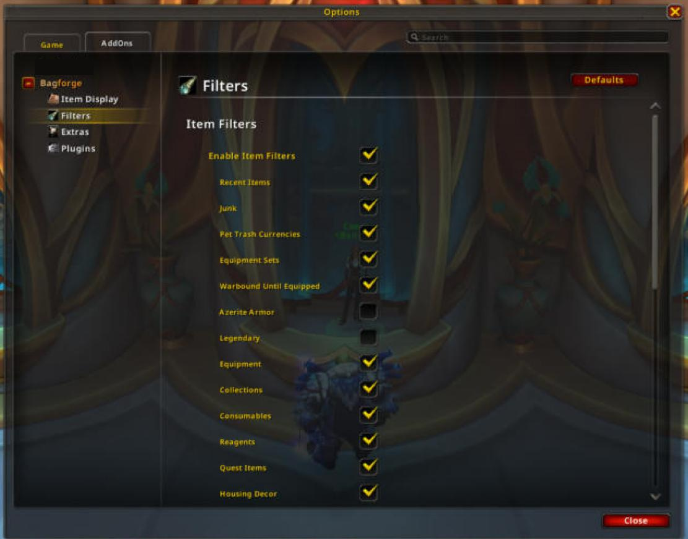
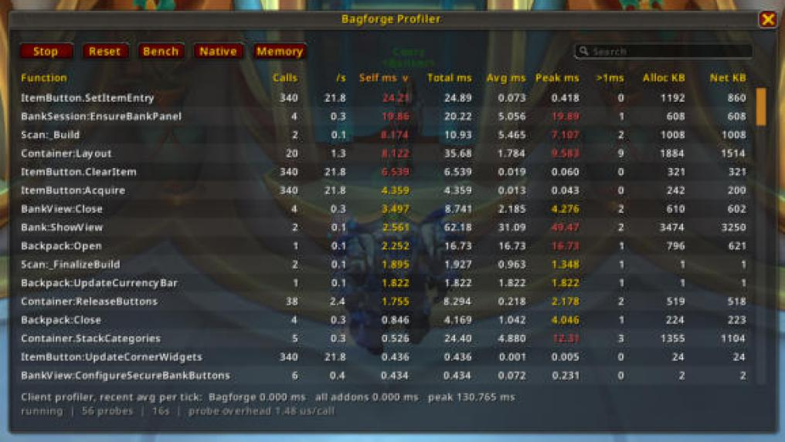

# Bagforge

[](https://github.com/Kkthnx-Wow/Bagforge/releases/latest)
[](https://www.curseforge.com/wow/addons/bagforge)
[](LICENSE)

Bagforge replaces the default backpack and bank windows in World of Warcraft Midnight with panels that group your items by type. It covers the character bank and the warband bank, and it can measure its own cost so slowdowns can be tracked down instead of guessed at.

<p align="center">
  
  
</p>

## What you get

**Panels instead of one long grid**

- Items sort into panels for Recent Items, Equipment, Equipment Sets, Warbound Until Equipped, Collections, Consumables, Reagents, Quest Items, Housing Decor, Junk and more. Each panel can be switched on or off.
- A Reagent Bag panel appears when you have a reagent bag equipped, and Legacy, Lower Level, Azerite, Legendary, Anima and Primordial Stone panels are there if you want them.
- Panel headers show item counts, the junk panel shows the vendor value of what is in it, and every panel can have its own header color.
- Choose how items sort inside a panel by quality, name, item level, expansion or vendor value.
- Set columns and icon size separately for the backpack, the character bank and the warband bank.

**A bank that works with you**

- The character bank and warband bank each get their own window with a tab bar to switch between them.
- Sort, deposit all, and pick which tab a deposit goes to. Warband gold deposit and withdraw work from the window footer.
- Each window remembers its own position.

<p align="center">
  
</p>

**Find things fast**

- A search box on every window dims what does not match, or hides it if you prefer.
- Searches understand rules such as `type:glyph`, `sub:herb | sub:cloth`, `gear ilvl>=600 !boe`, `quality>=epic` and `tt:use:` for tooltip text.
- Save a search by right-clicking the search box, then apply it again with one click. Saved searches work in the backpack, the bank and the warband bank.
- Alt-click an item to flash every matching stack in your open bags and bank.

**Make it yours**

- Assign any item to a custom category, rename and recolor categories, and reorder them from the category manager.
- Turn a saved search into a panel of its own, so a rule like "epic gear that is not BoE" gets its own place in your bags.
- Mark custom junk once and it follows you across characters.
- Lock slots so deposits and vendor sweeps leave them alone.
- Merge identical stacks into one button, with an option to leave partial stacks alone.

**Item details at a glance**

- Item level on equippable gear, colored by quality.
- Bind labels for BoE, BoU, BoA and Warbound Until Equipped.
- A red tint on gear you cannot use, a grey tint on junk, and an upgrade arrow when Pawn finds one.
- Choose which corner each overlay sits in.
- Specialty bag slots on the bag bar are tinted by bag type.

**Quality of life**

- Auto-open your bags at a trade, merchant, mailbox, auction house or scrapping machine.
- Auto sell junk and auto repair at vendors, with the option to repair from guild funds first. Bags flagged to ignore junk are respected.
- Delete Cheapest finds the lowest value item in your bags and asks before it deletes anything. Protect whole item types from it.
- A currency bar and money display on the backpack, and a bag bar for your equipped bags.
- Masque skins for item buttons and the bag bar.

## Screenshots

<p align="center">
  
  
</p>

## Install

Install from [CurseForge](https://www.curseforge.com/wow/addons/bagforge), or download the zip from the [latest release](https://github.com/Kkthnx-Wow/Bagforge/releases/latest) and extract the `Bagforge` folder into `World of Warcraft/_retail_/Interface/AddOns`. Then restart the game or type `/reload`.

Bagforge is built for Midnight, patch 12.1.5. It is a retail addon.

## Using it

Open your bags the way you always do, or type `/bf`. Everything in the settings is under Esc, Options, AddOns, Bagforge, or type `/bf config`.

| Command | What it does |
| --- | --- |
| `/bf` | Open or close the bags |
| `/bf config` | Open the settings |
| `/bf sort` | Sort and stack the bags |
| `/bf sortbank`, `/bf sortwarbank` | Sort the character or warband bank |
| `/bf depositbank`, `/bf depositwarbank` | Deposit items into the character or warband bank |
| `/bf reset`, `/bf resetbank`, `/bf resetwarbank` | Put a window back in its default spot |
| `/bf columns <number>` | Set backpack columns |
| `/bf bankcolumns <number>`, `/bf warbandcolumns <number>` | Set bank columns |
| `/bf filter <name> on\|off` | Switch a category filter on or off |
| `/bf cat <add\|remove\|clear\|order\|list>` | Manage custom categories |
| `/bf junk <add\|remove\|clear\|list>` | Manage custom junk |
| `/bf profile` | Open the profiler window |
| `/bf diag` | Check the scanner and show how long the last rebuild took |

## Profiling

Bagforge can measure itself. `/bf profile` opens a sortable table of where it spends time and memory, with calls per second, self and total time, peak time, calls over one millisecond and allocation per function. Hover a row to see the call stack of its slowest call, and right-click it to print that stack to chat.

<p align="center">
  
</p>

Press Start, use your bags and bank, and read the table. `/bf profile bench` times fixed workloads against your real bags, `/bf profile native` reads the client's own addon profiler next to Bagforge's numbers, and `/bf profile mem` reports memory, pools and scanners. Probes are installed when you start and removed when you stop, so nothing is measured while the profiler is off. Results are also saved to `BagforgeDB.profile` so a report can be read from disk after a reload.

If you report a slowdown, a screenshot of this table helps a lot.

## For addon authors

Other addons can add to Bagforge through `Bagforge.API`.

- Categories route matching items into a named panel.
- Sort modes appear in the item sort dropdown.
- Corner widgets draw small overlays on item buttons.
- Item button callbacks give you the whole button for larger overlays.
- Junk detectors mark items as junk.

Every plugin function is called in a protected call, so a faulty plugin cannot break a scan or a sort, and each plugin shows on the Plugins settings page where the player can switch it off.

```lua
local API = Bagforge and Bagforge.API
if API then
    API:RegisterCategory({
        key = "myaddon.herbs", source = "MyAddon",
        name = "Herbs", order = 13.5,
        filter = function(entry) return entry.itemSubType == "Herb" end,
    })
end
```

## Works with

Masque, Pawn and CanIMogIt are picked up automatically when they are installed. None of them are required.

## Support the work

Free forever. If it saved you time, chip in.

- [Ko-fi](https://ko-fi.com/kkthnx)
- [Buy Me a Coffee](https://buymeacoffee.com/kkthnx)
- [PayPal](https://www.paypal.com/paypalme/kkthnxtv)

Every bit goes back into building more.

## Community

- Glitch Haven Discord at https://discord.gg/FaVGhTYmck
- Website at https://kkthnx.com
- Bug reports and ideas in the [issue tracker](https://github.com/Kkthnx-Wow/Bagforge/issues)

## License

Released under the MIT License. See LICENSE for details.
